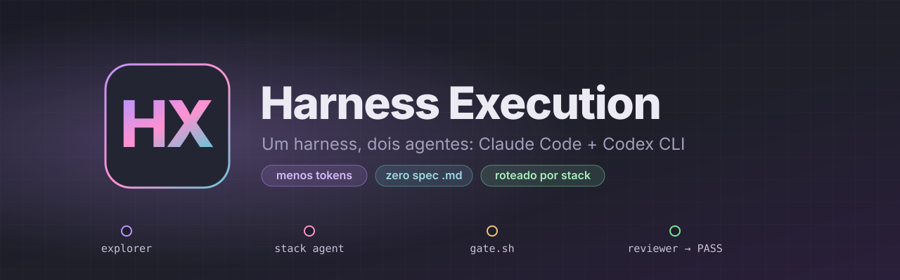

<p align="center">
  
</p>

<p align="center">
  <a href="LICENSE"></a>
  
  
  
  
</p>

<p align="center">
  <b>One agent harness for Claude Code and Codex CLI.</b><br>
  Fewer tokens, no throwaway spec <code>.md</code> files in your repo, and every task routed to the right stack agent.
</p>

<p align="center"><b>English</b> · <a href="docs/README.pt-BR.md">Português</a></p>

---

## Why

Coding agents burn tokens in three places: context nobody asked for, text nobody reads, and rework caused by skipped validation. HX goes after all three:

| Problem | What HX does |
|---|---|
| Bloated context | A fixed lookup order: code graph → memory by query → surgical reads. The `explorer` agent returns a **Context Pack of at most 30 lines**. |
| Preloaded skills | Skills live in `skills/` and are read **only when a phase needs them**. Nothing enters the prompt by default. |
| `plan.md`, `analysis.md`, `notes.md`… | The `block-spec-md.sh` hook **blocks** creating intermediate Markdown. Plans stay in the conversation. |
| "Done" without proof | `gate.sh` runs typecheck, lint and tests **only for changed files**. No `GATE: PASS`, not done. |
| Two tools, two configs | `AGENTS.md` is the single source, linked to `~/.claude/CLAUDE.md` and `~/.codex/AGENTS.md`. Agents are generated as `.md` (Claude) and `.toml` (Codex) by `sync.py`. |

## Install

Requirements: `git`, `bash` (Git Bash on Windows) and Python 3.11+. No third-party Python packages.

```bash
git clone https://github.com/paulopanissa/harness-execution ~/.hx
python3 ~/.hx/scripts/install.py      # Windows: py ~/.hx/scripts/install.py
```

The installer:

1. asks whether you want a **private org module** (optional, see below);
2. writes `~/.hx/config.yaml` and wires `AGENTS.md`, agents, commands and hooks into Claude Code and Codex;
3. validates everything (links, frontmatter, TOML, hooks);
4. offers the **UI mods** from the catalog. Nothing is preselected; you choose.

Non-interactive flags: `--no-org`, `--org <url>`, `--mods filetree,hx-skin`, `--no-mods`.

After editing anything in `~/.hx`, run `python3 ~/.hx/scripts/sync.py` (`--dry-run` to preview).

### Updating

No reinstall needed. `update.py` fast-forwards `~/.hx`, pulls the org repos if enabled, re-syncs and validates. Your `config.yaml`, mods and memory are git-ignored and stay untouched.

```bash
python3 ~/.hx/scripts/update.py --check   # is there a new version?
python3 ~/.hx/scripts/update.py           # apply it (--autostash if you edited tracked files)
```

See [CHANGELOG.md](CHANGELOG.md) for what changed.

### Language

Rules ship in English (also the cheapest in tokens). A full Brazilian Portuguese set lives in `i18n/pt-BR/`. The agent always replies in your language either way.

```yaml
# ~/.hx/config.yaml
language: pt-BR   # en (default) | pt-BR
```

Then run `sync.py`. A file missing from a translation falls back to English.

## Using it in your projects: nothing to configure

HX lives on **your machine**, not in your repositories. The installer links `AGENTS.md` as your global `~/.claude/CLAUDE.md` and `~/.codex/AGENTS.md`, and puts `/hx` in your user commands. So:

- open any project (new, cloned, or imported) and type `/hx <task>`; it just works;
- you do **not** add anything to the project's `CLAUDE.md`, `.claude/` or `.codex/`;
- nothing from HX is committed to the project, and teammates without HX are not affected;
- the project's own `CLAUDE.md` still applies for domain rules (stack, commands, code style).

You do not need to edit `~/.claude.json` or `settings.json` by hand either: `sync.py` merges the hooks it needs and keeps a backup.

## Context setup: Graphify + ai-memory (recommended)

`AGENTS.md` tells the agent to gather context in this order: **Graphify → ai-memory → surgical reads**. Both tools are optional. Without them HX falls back to a module-scoped `rg` plus `~/.hx/fallback-memory.jsonl`, which works but costs more tokens.

### Graphify: code graph

[safishamsi/graphify](https://github.com/safishamsi/graphify) builds a graph of your repository (symbols, dependencies, call sites). The agent queries it through the CLI instead of reading whole files.

```bash
uv tool install graphifyy            # or: pipx install graphifyy  (the package name has two "y")
graphify install                     # Claude Code skill
graphify install --platform codex    # Codex skill
```

In each repository:

```bash
/graphify .                # inside Claude Code (Codex: $graphify .)
graphify hook install      # rebuild the graph on every commit/checkout
graphify update .          # after a git pull
```

Output goes to `graphify-out/`; add it to the project's `.gitignore`. Code is parsed locally (tree-sitter); docs and images are sent to the model API with your own key.

### ai-memory: memory by query

[alphaonedev/ai-memory-mcp](https://github.com/alphaonedev/ai-memory-mcp) is a SQLite-backed MCP memory server. `explorer` pulls gotchas with 1 to 3 queries, and the `memory-distill` skill stores 3 to 5 durable facts at the end of each task.

```bash
cargo install ai-memory
# macOS/Linux alternative:
curl -fsSL https://raw.githubusercontent.com/alphaonedev/ai-memory-mcp/main/install.sh | sh
```

Register it under the name **`ai-memory`**, which is the name `AGENTS.md` uses. Prefer an absolute `--db` path:

```bash
claude mcp add ai-memory --scope user -- ai-memory --db "$HOME/.claude/ai-memory.db" mcp --tier semantic
codex mcp add ai-memory -- ai-memory --db "$HOME/.claude/ai-memory.db" mcp --tier semantic
```

Pointing both tools at the same `--db` lets Claude Code and Codex share one memory. Tools exposed: `memory_store`, `memory_recall`, `memory_search`.

Using Obsidian? Swap in a vault-backed memory MCP such as [mem-vault](https://github.com/jagoff/mem-vault) or [obsidian-memory-mcp](https://github.com/YuNaga224/obsidian-memory-mcp) and register it as `ai-memory`. The rule stays the same: the agent queries memory and never reads the whole vault.

### Without either

Everything still works, at a higher token cost. Memory goes to `~/.hx/fallback-memory.jsonl` (one JSON line per fact) and is searched with `rg`.

## Flow

```text
/hx <issue | work item | URL | text>
  └─ explorer          read-only, Context Pack ≤ 30 lines
      └─ stack agent   node-ts-dev · react-ts-dev · python-dev · gamedev-dev
          └─ gate.sh   typecheck + lint + tests related to the diff
              └─ reviewer  PASS  or  file:line — error
                  └─ PR summary (5 bullets) + memory distillation
```

The agent pauses only for: critical ambiguity, failure after 2 attempts, and before push/PR.

### Commands

| Command | Does |
|---|---|
| `/hx <input>` | the full flow above |
| `/hx:fix <error>` | root cause first, minimal fix, gate |
| `/hx:test` | tests only for new/changed paths |
| `/hx:pre-pr` | gate + review + PR summary |
| `/hx:game <feature>` | gamedev flow (loop, ECS, perf budget) |
| `/hx:clean-legacy` | strips old orchestrator config from `CLAUDE.md` |
| `/hx:org <phase> <id>` | one phase of the org flow (org module only) |

In Codex the same commands work as plain text: `AGENTS.md` tells the agent to read `~/.hx/commands/<file>.md`.

### Agents

| Agent | When | Access |
|---|---|---|
| `explorer` | always first | read-only |
| `node-ts-dev` | Node, NestJS, Prisma, APIs, queues | write |
| `react-ts-dev` | React, Next.js, Tailwind, UI | write |
| `python-dev` | Python, FastAPI, automation, AI pipelines | write |
| `gamedev-dev` | game loop, ECS, physics, shaders | write |
| `reviewer` | diff + gate + security | read-only |

Models per tier (`fast`, `default`, `deep`) are set in `config.yaml`, separately for Claude and Codex.

## UI mods

Mods change the Claude Code interface (panes, bars, themes). **They run outside the model: zero tokens**, unless the catalog says otherwise.

```bash
python3 ~/.hx/scripts/mod.py list
python3 ~/.hx/scripts/mod.py install hx-skin filetree
python3 ~/.hx/scripts/mod.py remove filetree
```

| Mod | What it is | Source |
|---|---|---|
| `filetree` | live tree of files read/edited | [data-goblin/claude-code-filetree](https://github.com/data-goblin/claude-code-filetree) |
| `blast-radius` | impact of each edit | [hamzafer/claude-code-mods](https://github.com/hamzafer/claude-code-mods) |
| `savvy-progress` | turn progress bar | [Berkay2002/berkays-mods](https://github.com/Berkay2002/berkays-mods) |
| `hx-skin` | **Dusk** (a refined Dracula), **Ember** and **Tide** skins; `/hx-skin` switches | this repo, `mods/hx-skin` |
| `claude-skins` | community skin pack (manual install) | [basicScandal/claude-skins](https://github.com/basicScandal/claude-skins) |

The catalog (`mods/catalog.json`) has a `codex` list reserved for when Codex gets equivalent mods. PRs adding mods are welcome.

## Org module (private, optional)

Companies usually have their own flow (phases, branch naming, guard hooks). **None of that ships in this repo.** HX only knows how to read a *preset* that you keep in a private repository:

```yaml
# hx-org.yaml (in YOUR private repo)
name: acme
vendor_repo: git@github.com:acme/agent-flow.git   # where each phase file lives
remote_pattern: github\.com[:/]acme/              # active only in company repos
claude_md_marker: acme-agent-flow                 # or when the local CLAUDE.md mentions this
phase_path: phases/{phase}.md
phases: discovery,kickoff,work,pre-pr,pr
branch_regex: ^(fix|feat|chore|refactor)/{id}$
guard_hooks: test-db-guard.js                     # optional, hooks from the vendor repo
```

```bash
python3 ~/.hx/scripts/install.py --org git@github.com:acme/hx-preset.git
```

The preset and the flow repo are cloned into `~/.hx/vendor/` (git-ignored) and refreshed in the background every `auto_update_days`. Outside company repos, org mode turns itself off.

## Measuring tokens

```bash
python3 ~/.hx/scripts/measure.py baseline --lang all     # what HX adds to context
python3 ~/.hx/scripts/measure.py sessions --days 7       # real usage from local transcripts
python3 ~/.hx/scripts/measure.py sessions --project my-api --tool claude --json
```

`baseline` estimates the always-loaded part (`AGENTS.md` + agent/command descriptions, about 1.6k tokens) and each on-demand file. `sessions` sums the usage recorded by Claude Code (`~/.claude/projects`) and Codex (`~/.codex/sessions`) per project: uncached input, cache writes, cache reads, output and cache hit rate. Nothing leaves your machine.

## Layout

```text
~/.hx
├── AGENTS.md            single source of rules (Claude + Codex)
├── agents/              6 agents → .md (Claude) and .toml (Codex)
├── commands/            /hx and subcommands
├── skills/              core · quality · stack · gamedev (on demand)
├── i18n/pt-BR/          full Brazilian Portuguese rule set
├── hooks/               block-spec-md · read-guard · org-only · strip-legacy-oc
├── scripts/             install · update · sync · gate · measure · mod · check_updates
├── tests/               unittest suite (run in CI on Ubuntu and Windows)
├── mods/                catalog + hx-skin
├── docs/                translations
└── vendor/              (local) private org module
```

## Rules enforced by `AGENTS.md`

- Short answers; never repeat code already on disk, cite `file:line`.
- Context: code graph → memory by query → surgical reads. No repo-wide scans.
- Enforced by hooks, not only by prompt: no intermediate plan/spec `.md` (`block-spec-md.sh`), no whole-file read over 400 lines (`read-guard.sh`; bypass `HX_ALLOW_READ=1`).
- Library docs via Context7 before guessing an API.
- Conventional commits; commit, push and PR only after confirmation.
- Bugs: root cause before editing; 3 failed attempts → stop and report.

## Development

```bash
python3 -m unittest discover -s tests -t tests
```

The suite runs sync, update and the hooks inside a throwaway sandbox (its own `HX_HOME`, Claude and Codex homes), so it never touches your real install.

## License

[MIT](LICENSE). Use it, adapt it, send a PR.
