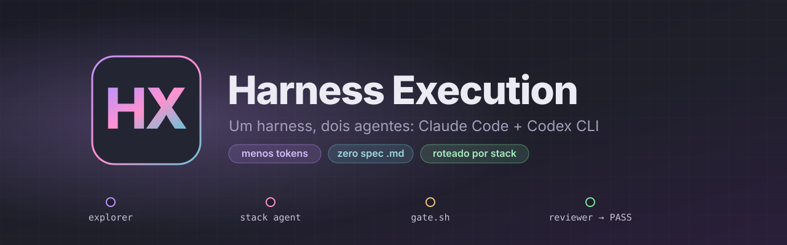

<p align="center">
  
</p>

<p align="center">
  <a href="../LICENSE"></a>
  
  
  
  
</p>

<p align="center">
  <b>Um único harness de agentes para Claude Code e Codex CLI.</b><br>
  Menos tokens, nenhum <code>.md</code> de spec perdido no repo, e cada tarefa roteada para o agente certo da stack.
</p>

<p align="center"><a href="../README.md">English</a> · <b>Português</b></p>

---

## Por que existe

Agentes de código gastam token em três lugares: contexto que ninguém pediu, texto que ninguém lê e retrabalho por falta de validação. O HX ataca os três:

| Problema | O que o HX faz |
|---|---|
| Contexto inchado | Hierarquia obrigatória: grafo de código → memória por query → leitura cirúrgica. O `explorer` entrega um **Context Pack de no máximo 30 linhas**. |
| Skills pré-carregadas | Skills ficam em `skills/` e só são lidas **quando a fase pede**. Nada entra no prompt por padrão. |
| `plan.md`, `analysis.md`, `notes.md`… | Hook `block-spec-md.sh` **bloqueia** a criação de `.md` intermediário. Plano vive na conversa. |
| "Pronto" sem prova | `gate.sh` roda typecheck, lint e testes **só dos arquivos alterados**. Sem `GATE: PASS`, não está pronto. |
| Duas ferramentas, duas configs | `AGENTS.md` é a fonte única, linkada em `~/.claude/CLAUDE.md` e `~/.codex/AGENTS.md`. Agentes viram `.md` (Claude) e `.toml` (Codex) gerados pelo `sync.py`. |

## Instalação

Requisitos: `git`, `bash` e Python 3.11+. Nenhum pacote Python de terceiros. No Windows, o `bash` é o Git Bash que vem com o Git for Windows: os hooks rodam nele, e `install.py`, `sync.py` e `update.py` rodam pelo PowerShell ou Cmd.

### 1. Pré-requisitos

macOS (Homebrew):

```bash
brew install git python@3.12
```

Linux (Debian/Ubuntu; no Fedora use `sudo dnf install git python3`):

```bash
sudo apt install git python3
python3 --version   # precisa ser 3.11 ou mais novo
```

Windows (PowerShell ou Cmd); depois abra um terminal novo para o `PATH` atualizar:

```powershell
winget install Git.Git
winget install Python.Python.3.12
```

### 2. Clonar e rodar o instalador

macOS / Linux:

```bash
git clone https://github.com/paulopanissa/harness-execution ~/.hx
python3 ~/.hx/scripts/install.py
```

Windows, PowerShell:

```powershell
git clone https://github.com/paulopanissa/harness-execution "$HOME\.hx"
py "$HOME\.hx\scripts\install.py"
```

Windows, Cmd:

```bat
git clone https://github.com/paulopanissa/harness-execution "%USERPROFILE%\.hx"
py "%USERPROFILE%\.hx\scripts\install.py"
```

O instalador:

1. pergunta se você quer um **módulo corporativo privado** (opcional, veja abaixo);
2. pergunta se liga o **RTK**, só se o binário `rtk` já estiver instalado (veja [Ferramentas opcionais](#ferramentas-opcionais-graphify-ai-memory-rtk));
3. grava `~/.hx/config.yaml`, liga `AGENTS.md`, agentes, comandos e hooks no Claude Code e no Codex;
4. valida tudo (links, frontmatter, TOML, hooks);
5. oferece os **mods de UI** do catálogo. Nenhum vem marcado; você escolhe.

Flags para rodar sem perguntas: `--no-org`, `--org <url>`, `--mods filetree,hx-skin`, `--no-mods`, `--rtk`, `--no-rtk`.

Depois de editar qualquer coisa em `~/.hx`, rode o `sync.py` (`--dry-run` para ver antes).

> **Comandos deste README** estão escritos para macOS/Linux (`python3 ~/.hx/scripts/...`). No Windows use `py "$HOME\.hx\scripts\..."` no PowerShell ou `py "%USERPROFILE%\.hx\scripts\..."` no Cmd. As CLIs das ferramentas (`graphify`, `rtk`, `claude`, `codex`) são iguais em todo SO, salvo quando a seção diz o contrário.

### Atualizando

Não precisa reinstalar. O `update.py` faz fast-forward em `~/.hx`, atualiza os repos org (se ativos), sincroniza e valida. `config.yaml`, mods e memória ficam fora do git e não são tocados, então ajustes como `rtk: true` continuam valendo. Ele não atualiza as ferramentas opcionais; cada uma tem o próprio comando de upgrade (veja abaixo).

```bash
python3 ~/.hx/scripts/update.py --check   # tem versão nova?
python3 ~/.hx/scripts/update.py           # aplica (--autostash se você editou arquivos versionados)
```

O que mudou: [CHANGELOG.md](../CHANGELOG.md).

### Idioma

As regras vêm em inglês (também o mais barato em tokens). O conjunto completo em português fica em `i18n/pt-BR/`. Nos dois casos o agente responde no seu idioma.

```yaml
# ~/.hx/config.yaml
language: pt-BR   # en (padrão) | pt-BR
```

Depois rode `sync.py`. Arquivo sem tradução cai para o inglês.

## Usando nos seus projetos: nada para configurar

O HX mora **na sua máquina**, não nos repositórios. O instalador liga o `AGENTS.md` como seu `~/.claude/CLAUDE.md` global e `~/.codex/AGENTS.md`, e coloca o `/hx` nos comandos de usuário. Então:

- abra qualquer projeto (novo, clonado ou importado) e digite `/hx <tarefa>`; funciona direto;
- você **não** adiciona nada no `CLAUDE.md`, `.claude/` ou `.codex/` do projeto;
- nada do HX é commitado no projeto, e quem não usa HX não é afetado;
- o `CLAUDE.md` do próprio projeto continua valendo para regras de domínio (stack, comandos, estilo).

Também não precisa editar `~/.claude.json` ou `settings.json` na mão: o `sync.py` mescla os hooks necessários e guarda backup.

## Fluxo

```text
/hx <issue | WI | URL | texto>
  └─ explorer        read-only, Context Pack ≤ 30 linhas
      └─ agente da stack   node-ts-dev · react-ts-dev · python-dev · gamedev-dev
          └─ gate.sh       typecheck + lint + testes relacionados ao diff
              └─ reviewer  PASS  ou  arquivo:linha — erro
                  └─ resumo de PR (5 bullets) + destilação de memória
```

Pausa só em três casos: ambiguidade crítica, falha após 2 tentativas, antes de push/PR.

### Comandos

| Comando | Faz |
|---|---|
| `/hx <entrada>` | pipeline completo acima |
| `/hx:fix <erro>` | causa raiz primeiro, correção mínima, gate |
| `/hx:test` | testes só do caminho novo/alterado |
| `/hx:pre-pr` | gate + review + resumo de PR |
| `/hx:game <feature>` | fluxo de gamedev (loop, ECS, perf budget) |
| `/hx:clean-legacy` | remove configs de orquestradores antigos do `CLAUDE.md` |
| `/hx:org <fase> <id>` | fase do fluxo corporativo (só com módulo org ativo) |

No Codex, o TUI rejeita `/hx` customizado, então o `sync.py` gera os comandos como skills: digite `$hx`, `$hx-fix`, `$hx-pre-pr`… (em `~/.agents/skills/`). Um `/hx…` digitado como texto continua funcionando: o `AGENTS.md` instrui o agente a ler `~/.hx/commands/<arquivo>.md`.

### Agentes

| Agente | Quando | Acesso |
|---|---|---|
| `explorer` | sempre primeiro | read-only |
| `node-ts-dev` | Node, NestJS, Prisma, APIs, filas | escrita |
| `react-ts-dev` | React, Next.js, Tailwind, UI | escrita |
| `python-dev` | Python, FastAPI, automação, IA | escrita |
| `gamedev-dev` | game loop, ECS, física, shaders | escrita |
| `reviewer` | diff + gate + segurança | read-only |

Modelo por tier (`fast`, `default`, `deep`) é configurável em `config.yaml`, separado para Claude e Codex.

## Mods de UI

Mods mudam a interface do Claude Code (painéis, barras, temas). **Rodam fora do modelo: zero token**, salvo onde o catálogo avisa.

```bash
python3 ~/.hx/scripts/mod.py list
python3 ~/.hx/scripts/mod.py install hx-skin filetree
python3 ~/.hx/scripts/mod.py remove filetree
```

| Mod | O que é | Origem |
|---|---|---|
| `filetree` | árvore de arquivos lidos/editados, ao vivo | [data-goblin/claude-code-filetree](https://github.com/data-goblin/claude-code-filetree) |
| `blast-radius` | impacto de cada edição | [hamzafer/claude-code-mods](https://github.com/hamzafer/claude-code-mods) |
| `savvy-progress` | barra de progresso do turno | [Berkay2002/berkays-mods](https://github.com/Berkay2002/berkays-mods) |
| `hx-skin` | skins **Dusk** (Drácula refinado), **Ember** e **Tide**; `/hx-skin` troca | este repo, `mods/hx-skin` |
| `claude-skins` | pacote da comunidade (manual) | [basicScandal/claude-skins](https://github.com/basicScandal/claude-skins) |

O catálogo (`mods/catalog.json`) tem uma lista `codex` reservada para quando o Codex tiver mods equivalentes. PRs com novos mods são bem-vindos.

## Módulo org (privado e opcional)

Empresas costumam ter um fluxo próprio (fases, padrão de branch, guardas). O HX **não traz nada disso no repo público**. Ele só sabe ler um *preset* que você mantém num repositório privado:

```yaml
# hx-org.yaml (no SEU repo privado)
name: acme
vendor_repo: git@github.com:acme/agent-flow.git   # onde ficam os arquivos de cada fase
remote_pattern: github\.com[:/]acme/              # ativa só em repos da empresa
claude_md_marker: acme-agent-flow                 # ou quando o CLAUDE.md local cita isto
phase_path: phases/{phase}.md
phases: discovery,kickoff,work,pre-pr,pr
branch_regex: ^(fix|feat|chore|refactor)/{id}$
guard_hooks: test-db-guard.js                     # opcional, hooks do vendor
```

```bash
python3 ~/.hx/scripts/install.py --org git@github.com:acme/hx-preset.git
```

Preset e fluxo são clonados em `~/.hx/vendor/` (ignorado pelo git) e atualizados em background a cada `auto_update_days`. Fora dos repos da empresa, o modo org fica desligado sozinho.

## Ferramentas opcionais: Graphify, ai-memory, RTK

O `AGENTS.md` manda o agente buscar contexto nesta ordem: **Graphify → ai-memory → leitura cirúrgica**, e o RTK enxuga a saída de Bash que o agente lê. As três são recomendadas e as três são opcionais.

**São projetos open source separados.** O HX não empacota, não copia nem faz fork do código delas, não fixa branch delas e nunca as baixa. Você instala cada binário; o HX só faz a ligação (regras no `AGENTS.md`, hooks registrados pelo `sync.py`). Ferramenta ausente é pulada e nada quebra.

| Ferramenta | Economiza tokens em | Como o HX liga |
|---|---|---|
| [Graphify](https://github.com/safishamsi/graphify) | ler arquivo inteiro para achar símbolo | hook `SessionStart` monta o grafo por repo, automático |
| [ai-memory](https://github.com/alphaonedev/ai-memory-mcp) | redescobrir as mesmas pegadinhas | servidor MCP que você registra uma vez; `explorer` e `memory-distill` consultam |
| [RTK](https://github.com/rtk-ai/rtk) | saída longa de `git`, testes e build | hook `PreToolUse` Bash, registrado pelo `sync.py` com `rtk: true` |

> Os instaladores de uma linha abaixo passam um script remoto direto para o shell. Leia o script antes se não confiar na origem.

### Graphify: grafo de código

O Graphify monta um grafo do repositório (símbolos, dependências, chamadas). O agente consulta pela CLI em vez de ler arquivos inteiros.

Instale o `uv` antes:

| SO | Comando |
|---|---|
| macOS | `brew install uv` |
| Linux | `curl -LsSf https://astral.sh/uv/install.sh \| sh` |
| Windows (PowerShell ou Cmd) | `winget install astral-sh.uv` |

Depois, em qualquer SO e shell:

```bash
uv tool install graphifyy            # o pacote tem dois "y" (ou: pipx install graphifyy)
graphify install                     # skill do Claude Code
graphify install --platform codex    # skill do Codex
```

`graphify` não encontrado depois? Rode `uv tool update-shell` e abra um terminal novo. Para atualizar: `uv tool upgrade graphifyy`.

**Setup automático (Claude Code).** O `sync.py` registra o hook `SessionStart` `hooks/graphify-setup.sh`. Nada de config por projeto. Quando a sessão abre dentro de um repositório git:

- `graphify` fora do `PATH` → um aviso curto por repositório, depois silêncio (marcador em `~/.hx/state/`).
- `graphify-out/` entra no `.gitignore` do projeto se faltar (idempotente, mantém os fins de linha do arquivo).
- Sem `graphify-out/` ainda → `graphify extract <repo> --code-only` roda em segundo plano: só AST local (tree-sitter), sem LLM, sem chave de API.
- Sem os git hooks do Graphify → `graphify hook install` (refaz o grafo em commit/checkout/merge; também registra um merge driver no `.gitattributes`).
- Já configurado → nada. Erro nunca quebra a sessão; vai para `~/.hx/.graphify.log`.

Para desligar: `HX_NO_GRAPHIFY=1`. Os comandos manuais continuam valendo:

```bash
/graphify .                # grafo completo com docs/imagens (Codex: $graphify .); usa a chave de API do seu modelo
graphify update .          # depois de um git pull
```

### ai-memory: memória por query

O ai-memory é um servidor MCP de memória em SQLite. O `explorer` puxa pegadinhas com 1 a 3 queries, e a skill `memory-distill` grava de 3 a 5 fatos duráveis no fim de cada tarefa.

Instalação:

macOS / Linux:

```bash
curl -fsSL https://raw.githubusercontent.com/alphaonedev/ai-memory-mcp/main/install.sh | sh
```

Windows, PowerShell:

```powershell
irm https://raw.githubusercontent.com/alphaonedev/ai-memory-mcp/main/install.ps1 | iex
```

Windows, Cmd:

```bat
powershell -NoProfile -ExecutionPolicy Bypass -Command "irm https://raw.githubusercontent.com/alphaonedev/ai-memory-mcp/main/install.ps1 | iex"
```

Qualquer SO com Rust: `cargo install ai-memory`.

Registre com o nome **`ai-memory`**, que é o nome usado no `AGENTS.md`. Use caminho absoluto no `--db`; no Windows, com barras normais (`/`).

macOS / Linux:

```bash
claude mcp add ai-memory --scope user -- ai-memory --db "$HOME/.claude/ai-memory.db" mcp --tier semantic
codex mcp add ai-memory -- ai-memory --db "$HOME/.claude/ai-memory.db" mcp --tier semantic
```

Windows, PowerShell (use `'--'` entre aspas: npm e Volta instalam `claude`/`codex` como shims `.ps1`, e o PowerShell engole um `--` solto antes de chegar neles):

```powershell
$db = "$($HOME -replace '\\','/')/.claude/ai-memory.db"
claude mcp add ai-memory --scope user '--' ai-memory --db $db mcp --tier semantic
codex mcp add ai-memory '--' ai-memory --db $db mcp --tier semantic
```

Windows, Cmd:

```bat
claude mcp add ai-memory --scope user -- ai-memory --db "%USERPROFILE:\=/%/.claude/ai-memory.db" mcp --tier semantic
codex mcp add ai-memory -- ai-memory --db "%USERPROFILE:\=/%/.claude/ai-memory.db" mcp --tier semantic
```

Confira com `claude mcp list` / `codex mcp list`. Apontar as duas ferramentas para o mesmo `--db` faz Claude Code e Codex dividirem a mesma memória. Ferramentas expostas: `memory_store`, `memory_recall`, `memory_search`.

Usa Obsidian? Troque por um MCP de memória baseado em vault, como [mem-vault](https://github.com/jagoff/mem-vault) ou [obsidian-memory-mcp](https://github.com/YuNaga224/obsidian-memory-mcp), e registre como `ai-memory`. A regra continua: o agente consulta a memória e nunca lê o vault inteiro.

### RTK: saída de Bash filtrada

O RTK reescreve os comandos Bash do agente antes de rodar (`git status` → `rtk git status`) e devolve uma saída compacta. Você trabalha normal; a economia aparece no `rtk gain`.

1. Instale o binário:

   | SO | Comando |
   |---|---|
   | macOS, ou Linux com Homebrew | `brew install rtk` |
   | Linux, macOS, WSL, Git Bash | `curl -fsSL https://raw.githubusercontent.com/rtk-ai/rtk/refs/heads/master/install.sh \| sh` |
   | Windows (PowerShell ou Cmd) | `winget install rtk-ai.rtk` |

2. Ligue no HX, de um dos dois jeitos:

   ```bash
   python3 ~/.hx/scripts/install.py --rtk   # ou "rtk: true" em ~/.hx/config.yaml e rode o sync.py
   ```

   O `sync.py` então adiciona `rtk hook claude` em `~/.claude/settings.json` e `rtk hook codex` em `~/.codex/hooks.json`. O hook só entra com `rtk: true` **e** `rtk` no `PATH`, para o Bash nunca quebrar.

3. Reinicie o Claude Code e o Codex para eles enxergarem o novo `PATH`.

4. Confira: `rtk init --show` lista `[ok] Hook: rtk hook claude` (a linha `RTK.md: not found` é esperada: a regra do RTK fica no `AGENTS.md`). Depois de trabalhar um pouco, `rtk gain` mostra os tokens economizados.

Bom saber:

- Quando a saída filtrada esconde um detalhe, o agente roda `rtk bypass <cmd>` sozinho.
- Só a ferramenta **Bash** é filtrada. Comandos que o Claude Code roda pela ferramenta PowerShell não passam pelo RTK.
- O `gate.sh` não é afetado: os comandos dentro dele rodam sem filtro, e na falha ele guarda o log completo em `~/.hx/state/gate-last-fail.log`.
- Atualizar: `brew upgrade rtk` ou `winget upgrade rtk-ai.rtk` (o `update.py` não mexe no binário).
- Desligar: `rtk: false` faz o `sync.py` parar de adicionar o hook, mas não remove um que já existe (o próprio RTK pode tê-lo instalado). Para remover de vez: `rtk init -g --uninstall`.

### Sem nenhuma delas

Tudo continua funcionando, com custo maior de tokens. A memória vai para `~/.hx/fallback-memory.jsonl` (uma linha JSON por fato) e é buscada com `rg`.

## Medindo tokens

```bash
python3 ~/.hx/scripts/measure.py baseline --lang all     # quanto o HX adiciona ao contexto
python3 ~/.hx/scripts/measure.py sessions --days 7       # uso real pelos transcripts locais
python3 ~/.hx/scripts/measure.py sessions --project minha-api --tool claude --json
```

`baseline` estima a parte sempre carregada (`AGENTS.md` + descrições de agentes/comandos, cerca de 1,6k tokens) e cada arquivo sob demanda. `sessions` soma o uso gravado pelo Claude Code (`~/.claude/projects`) e pelo Codex (`~/.codex/sessions`) por projeto: input sem cache, escrita e leitura de cache, output e taxa de acerto do cache. Nada sai da sua máquina.

## Estrutura

```text
~/.hx
├── AGENTS.md            fonte única de regras (Claude + Codex)
├── agents/              6 agentes → .md (Claude) e .toml (Codex)
├── commands/            /hx e subcomandos
├── skills/              core · quality · stack · gamedev (sob demanda)
├── i18n/pt-BR/          conjunto completo de regras em português
├── hooks/               block-spec-md · read-guard · org-only · strip-legacy-oc
├── scripts/             install · update · sync · gate · measure · mod · check_updates
├── tests/               suíte unittest (roda no CI em Ubuntu e Windows)
├── mods/                catálogo + hx-skin
└── vendor/              (local) módulo org privado
```

## Regras que o `AGENTS.md` impõe

- Respostas curtas; nunca repetir código já salvo, citar `arquivo:linha`.
- Contexto: grafo de código → memória por query → leitura cirúrgica. Nada de varrer o repo inteiro.
- Garantido por hook, não só por prompt: nada de `.md` intermediário de plano/spec (`block-spec-md.sh`) nem leitura inteira de arquivo com mais de 400 linhas (`read-guard.sh`; bypass `HX_ALLOW_READ=1`).
- Docs de biblioteca via Context7 antes de chutar API.
- Conventional commits; commit, push e PR só com confirmação.
- Bug: causa raiz antes de editar; 3 tentativas falhas → para e reporta.

## Desenvolvimento

```bash
python3 -m unittest discover -s tests -t tests
```

A suíte roda sync, update e os hooks num sandbox descartável (`HX_HOME`, Claude e Codex próprios), sem tocar na sua instalação real.

PRs são bem-vindos; leia antes o [CONTRIBUTING.pt-BR.md](CONTRIBUTING.pt-BR.md). Segurança: [SECURITY.md](../SECURITY.md).

## Licença

[MIT](../LICENSE). Use, adapte, mande PR.
